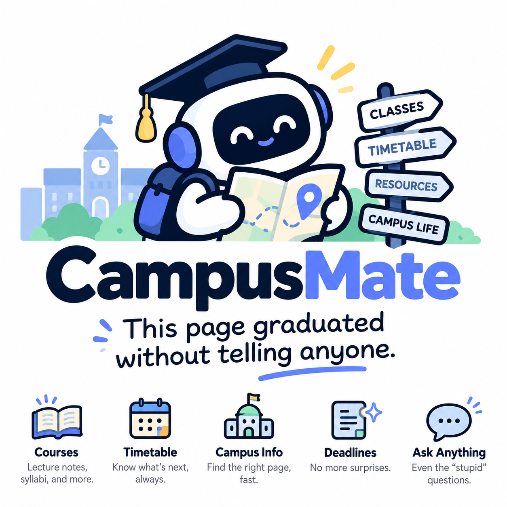

# campusMate




主品牌采用 [CampusMate 校园品牌视觉指南](web/brand/campusmate-visual-guide.png)。[图标、宣传图与使用说明](docs/BRAND.md) 可用于产品介绍和演示；其他主题保留各自标识。

已有 Python 环境可通过 [Windows 已有环境启动器](docs/LOCAL_UI.md) 在后台运行，并使用 `stop.cmd` 停止。默认双击入口由 uv 准备项目运行环境。

本地校园工作台，统一提供 Nord 界面、导航、设置、加密凭据、学校登录、统一 AI 服务与官方 DeepSeek Harness 插件运行时。模型设置沿用 Harness 内置的 39 个提供商目录，并支持三种自定义 API 协议；保存 API Key 后默认启用，密钥按提供商分别加密保存。首页默认展示待办、截止与今明日安排，学习助手入口可展开完整对话；采用居中阅读区、自适应输入框与明确的历史对话入口，支持 Markdown、流式回答，以及按账号保存在本机的新建、切换、归档和删除对话。学习助手能查询资料、规划作业、引用 PDF／PPTX 页码，并结合已有课程和培养方案讨论选课。

课程中心按本学期的课程整合 Blackboard、Gradescope、Piazza 与录播等平台的可用内容。邮箱默认显示分类文件夹和紧凑列表，点击邮件进入主阅读区，保留段落与表格格式；偏好保存后立即更新规则，并由 Harness 分批复核全部本地缓存邮件。当前课程的作业发布与学习材料优先关注，本科一、二年级默认关注形策，一年级关注心理活动，用户填写的完成状态优先。邮箱提供学校网页入口、日／周总结及跨模块分类 API，标明最近最多 100 封已同步邮件的范围。校园后台助手在资料更新后检查服务与重要事项，通过顶部铃铛和通知中心提醒；活动经明确参加确认后加入时间表，已筛选或不参加的活动同步收起相关提醒。时间表按周整合课程、截止时间、考试与个人安排，读取学校校历并保留按学期手动设置。侧栏根据模块启停显示分类，设置始终可用。

## 当前开发状态

2026-10-18 批次合并后进入演示代码冻结，固定版本使用 `demo-freeze-2026-10-18` 标签；冻结范围、验证与后续修改流程见 [冻结说明](docs/FREEZE.md)。

来源同步在后端执行，切换页面后继续，返回时恢复进度与结果。程序运行期间每分钟检查已连接来源的缓存，超过 6 小时自动刷新已有资料；账号过期和来源错误由用户检查后重试。Piazza 的逐页帖子采集也使用后端队列，模块停用或程序退出时结束任务。

时间表的个人安排和已确认活动可在详情中直接编辑或删除；确认框等待用户选择，取消后回到详情。后台再次检查同一活动时保留用户的删除结果。

已集成 19 个模块，Windows 原生运行；共享登录状态和本地学习资料可在重启后恢复。聊天、邮件分类与后台检查使用官方 DeepSeek Harness 原生插件，框架负责通用生命周期，业务判断与副作用留在模块中。多会话会迁移已有聊天记录；手动邮件分类和已编辑的时间安排优先保留。完整行为与边界见 [学习助手](modules/academic-assistant/README.md)、[邮箱](modules/mail/README.md)、[后台助手](modules/campus-agent/README.md) 和 [验收记录](docs/LIVE_ACCEPTANCE.md)。

[校园地图](modules/campus-map/README.md) 提供建筑与校门定位、当天课程地点、室外步行路线及电梯位置说明。施工和通行信息由用户核实后参与选路，公告与邮件发现默认关闭；可在设置中独立启停地图模块。

默认界面采用 Material 3 的分区、列表与操作层级，沿用 Nord 配色。设置 → 外观提供 Default · Nord、观星台、星夜手记和 PRTS · 学习终端，保存选择后重启继续使用。主题可只提供样式，也可替换模块界面，业务 API 和账号隔离保持统一。账号连接按服务展开；通知以摘要和详情组织，作业按状态与时间筛选。模型、插件配置与低频操作集中管理，菜单和弹窗有独立表面色与关闭路径；滚动区域使用细圆角滚动条。设计依据与主题开发接口见 [设计规范](docs/DESIGN.md) 和 [主题契约](docs/UI_THEME.md)。

[群消息](modules/group-messages/README.md) 接入本人微信本机只读采集和 QQ 本机 OneBot 轮询，支持选群、课程绑定、自动同步、带原文的信息提取、确认与撤销。自动应用由按群可信规则控制，活动仍需确认参加；群消息原文不进入其他后台工作流。

## 下一阶段开发方向

继续完善“连接学校账号 → 汇总本学期课程与作业 → 整理重要事项 → 用课程原文辅助学习”的真实使用链路，按以下顺序推进：

1. **真实来源验收与登录恢复。** 六个来源已完成真实账号的登录与基础同步验证，最近完成课表、Blackboard、Gradescope、Coremail 的重复同步和重启检查。已提供 IDS 本机免密码设备入口、过期恢复和按已验证账号隔离缓存；学校邮箱可使用 IMAP 专用密码登录，优先于容易过期的网页会话。验证范围及限制见 [真实来源验收](docs/LIVE_ACCEPTANCE.md)，用户连接步骤见 [认证文档](docs/AUTH.md)。继续覆盖学校协议变化、验证码与各来源文件正文，未知提交状态不列为未提交。
2. **验证带引用的学习建议。** 首页 [学习助手插件](modules/academic-assistant/README.md) 已接入按需查询、PDF／PPTX 页级文字、录播检索、已有课程记录、培养方案及课程目录／大纲查询。继续用真实问题核对作业建议与课程要求；界面说明发送至所选模型服务的资料范围，后端校验实际引用和账号版本后保存。扫描 PDF 与图片支持可配置的直接识图／本地 OCR；未公布的学期开课安排仍需补充。详见 [课件读取配置](docs/DOCUMENT_READING.md)。
3. **收敛演示界面与启动流程。** 课程中心负责课程总入口，来源面板突出连接状态和同步范围；统一失败重试、过期提示、空状态与首次引导。启动器默认在 Windows 运行并打开 Edge；接下来准备合成演示数据和 5 分钟演示脚本，按 [交付与移植规范](docs/DELIVERY.md) 验收后再接 Electron。

每项工作从最新主分支建立功能分支，仍按模块分工；共享身份、聚合契约和启动流程的变更作为集成任务处理。

## 启动

当前开发入口为 Windows 原生：Python 服务和官方 Harness 在 Windows 运行，工作台与学校登录使用 Windows Edge，凭据由当前 Windows 用户的 DPAPI 加密。需要 Windows uv、Git、Node.js 22+ 和 Edge；原生插件安装需要 pnpm，未安装 pnpm 时框架会自动通过 Node.js 自带的 Corepack 提供本地兜底。uv 根据 `.python-version` 和 `uv.lock` 准备 Python 3.12 及依赖；WSL 可通过 `--distro` 显式选择，继续作为 Linux 开发入口。官方 Harness 运行时随 Python 依赖安装。

在 Windows 双击 `run.cmd`，或运行：

```powershell
.\run.ps1
# 在 PowerShell/CMD 中也可直接使用 run.cmd
.\run.cmd --check
.\run.ps1 --port 17666
.\run.ps1 --distro Ubuntu-22.04
.\run.ps1 --no-browser
```

启动器默认使用 Windows 原生环境；指定 `--distro` 或 `CAMPUS_WSL_DISTRO` 时使用对应 WSL 发行版。`--distro` 或本机环境变量 `CAMPUS_WSL_DISTRO` 可指定个人选择，不修改系统默认发行版。路径从脚本目录解析，支持中文和空格。服务就绪后自动打开 Edge；重复双击会复用本项目已运行的实例。保留启动窗口，按 `Ctrl+C` 停止服务；失败时 `run.cmd` 暂停显示错误，便于查看。

默认端口为 16666，设置中修改后重启生效，`--port` 只覆盖当次运行。启动器确认本目录实例后复用已运行服务。`--help`、`--version` 不启动服务，`--check` 检查启动依赖。首次准备依赖需要联网；若 PATH 中没有 uv，启动器会用本机 Python/pip 将其安装到 `.private/runtime/tools/uv` 并复用，也可用 `CAMPUS_UV` 指定已有程序。uv 安装见 [官方说明](https://docs.astral.sh/uv/getting-started/installation/)。

在已配置环境的 WSL 中也可运行 `bash ./run.sh`，手动打开 [本地工作台](http://127.0.0.1:16666)。应用运行环境、缓存、启动状态和本机生成的 Windows 互操作脚本放在 `.private/runtime/`；开发环境与验证资料放在 `.codex/`，均不会提交。迁移源码时不复制虚拟环境；目标电脑重新准备依赖，详情见 [四人协作、打包与迁移](docs/DELIVERY.md)。

## AI 功能开发入口

AI 工具和工作流统一使用官方 DeepSeek Harness 后端运行时。每项新增能力在独立 `modules/<id>/harness/` 中实现原生 Cordis 插件，由模块管理负责启停与刷新；框架维护凭据、运行时适配和生命周期。基础文本对话和生成使用共享 `chat`、`generate`，插件任务使用 `context.ai.run(..., plugins=[模块ID])`。示例为 [截止时间整理](modules/deadlines/README.md)，可在 AI 助手的“插件任务”中选择。

需要按问题调用校园 API 的能力参考 [首页学习助手](modules/academic-assistant/README.md)：业务后端创建任务与工具授权，通过内部 `plugin_env` 注入本机调用信息，原生插件负责模型工具接口。带页面的插件从所属页面发起，纯工具插件从“插件任务”选择。学校会话和 API Key 留在共享服务，工具只把回答所需资料交给模型。

开始开发前阅读 [团队开发流程](docs/DEVELOPMENT.md#开发流程)、[AI 插件接口](docs/AI.md#原生-harness-插件) 和 [模块契约](docs/MODULES.md)。`main` 保存已整合且可运行的版本；功能在独立分支开发，完成验证与文档后通过 PR 合并。

## 目录与职责

| 目录 | 内容与维护者 |
| --- | --- |
| `web/` | 框架页面、导航、全局设置、共享组件和 Nord 设计变量；框架维护者负责 |
| `backend/core/`、`backend/main.py` | 生命周期、模块加载、数据隔离、本地接口保护；框架维护者负责 |
| `backend/services/auth/`、`scripts/` | 登录提供方、二次验证和会话管理；认证服务维护者负责 |
| `backend/services/ai/` | 提供商与模型配置、基础对话和官方 Harness 适配；AI 服务维护者负责 |
| `modules/<id>/` | 一项独立业务或 AI 插件模块，按需提供 `web/`、`server/`、`harness/` 与 `checks/` |
| `.private/` | 加密凭据、普通设置、各模块用户数据；整目录加入 Git 忽略规则 |
| `.private/runtime/` | 程序创建的运行环境、登录验证目录、Harness 工作区与缓存；随私有目录忽略 |
| `.codex/` | 当前项目的开发环境、缓存和验证临时数据；整目录加入 Git 忽略规则 |
| `checks/`、`docs/` | 框架和共享服务的最小检查、接口及团队规范 |

项目以空配置启动。账号、密码、Cookie、登录参数、AI Key 和模块秘密统一写入 `.private/vault.dpapi`；接口只返回配置及会话状态。普通设置保存在 `.private/settings.sqlite3`，模块文件存放在 `.private/modules/<id>/`。设置中可分别清除凭据、模块数据，或重置全部本地数据。私有资料和开发环境遵循项目 `.gitignore`。

设置 → 功能模块可读取当前请求、最近失败和后台线程状态；设置 → 本地设置提供模块数据备份、恢复和单份删除。清除或恢复模块数据前会自动保存一份；备份失败则不继续操作。备份位于 `.private/backups/`，不会随“清除当前数据”删除，需在备份列表单独删除；不含账号凭据、登录状态和 API Key。恢复使用当前账号，账号版本不匹配的记录继续隔离。错误提示带下一步操作和错误编号，便于定位问题。接口和恢复边界见 [统一 API](docs/API.md)。

DPAPI 密文绑定当前 Windows 用户；更换电脑或 Windows 账号后需重新配置凭据。登录验证使用 `.private/runtime/auth/` 中按服务固定的 Edge 资料，导入后关闭窗口并保留资料；断开账号或清除凭据时删除对应资料。Windows 会话密钥由操作系统管理，项目内保存密文。

## 统一开发方式

先开发网页和 HTTP API，使用 `modules/<id>/module.json` 注册业务模块；在设置中刷新即可发现，启停和更新以模块为单位进行。模块前端通过 `mount(container, context)` 挂载，后端通过 `create_router(context)` 暴露自己的接口。界面清理、后台任务停止和数据清除都遵循明确的生命周期，详见 [模块开发接口](docs/MODULES.md)。

登录通过 `context.auth` 复用，AI 通过 `context.ai` 调用，模块使用自己的 `context.store`、`context.secrets` 和 `context.data_dir` 管理数据。前端通过注入的 `context.api`、`context.services` 和 `context.ui` 使用接口及组件。API 基础路径为 `/api/v1`，运行后可查看 [交互式接口文档](http://127.0.0.1:16666/api/docs) 和 [OpenAPI](http://127.0.0.1:16666/api/openapi.json)。基础对话和生成使用设置中选择的模型服务；需要 AI 调用工具完成工作的新增功能在 `modules/<id>/harness/` 实现原生 Cordis 插件，通过官方 Harness 运行时的 `context.ai.run` 执行，并跟随模块热插拔。AI 助手的“插件任务”提供所选资料和截止时间整理工具的使用入口，详见 [插件接口](docs/AI.md#原生-harness-插件)。

Nord 基础变量在 `web/styles.css` 定义，主题在 `web/themes/nord-refined.css` 维护：Polar Night 用于侧栏与正文，Snow Storm 用于内容与浮层背景，Frost 用于操作和焦点，Aurora 用于状态提示。字体为微软雅黑 UI、微软雅黑和系统字体，工作区正文 14px，邮件与聊天长正文 16px，页面标题 26px；业务模块复用公共组件，并以模块根节点限定布局。完整配色、字号和组件用法见 [设计规范](docs/DESIGN.md)。

最后统一集成 Electron：桌面层负责窗口、标签页、系统浏览器与应用内打开方式及桌面能力，网页和模块继续使用相同的本地 API。当前开发入口为网页，模块通过 HTTP 和注入上下文与框架协作。

## 团队交接

每位成员负责明确的 1–3 个模块，在自己的功能分支开发；按可以完整评审的阶段提交 PR，日常小修改直接提交到自己的分支。主框架、共享认证、共享 AI、公共 UI 和业务模块分别设定负责人；跨职责变更先确认接口，再由对应负责人修改。业务模块保持独立，跨模块通过公开接口协作。具体目录边界、分支规则和 Ponytail 最简代码约定见 [团队开发约定](docs/DEVELOPMENT.md) 和 [AGENTS.md](AGENTS.md)。

## 验证与文档

在 Windows 运行 `powershell -NoProfile -ExecutionPolicy Bypass -File check.ps1`，或在 WSL 运行 `bash ./check.sh`。检查覆盖空配置、模块动态加载/更新/停用、模块存储隔离、本地接口保护、DPAPI 往返、登录流程、DeepSeek 模拟响应和官方 Harness 原生插件，并自动发现模块检查。学习资料集成检查覆盖 ELRC/Piazza 缓存、教育回答、统一助手与插件任务；夹具只在 `.codex/` 中生成，AI 响应使用本地模拟数据。

- [统一 HTTP API](docs/API.md)
- [模块生命周期与扩展接口](docs/MODULES.md)
- [认证、会话与二次验证](docs/AUTH.md)
- [AI 接入与上下文约定](docs/AI.md)
- [Nord 界面与组件](docs/DESIGN.md)
- [团队开发与修改边界](docs/DEVELOPMENT.md)
- [四人协作、打包与迁移](docs/DELIVERY.md)

交互式 API 页面从 jsDelivr 加载 Swagger UI；离线时可直接使用 OpenAPI JSON 和项目内接口文档。学校登录协议、二次验证和会话有效期由相应网站决定；以真实登录探测结果确认会话状态。

模块边界、独立启停与完整主分支约定见 [AGENTS.md](AGENTS.md) 和 [架构决策](docs/architecture/0001-module-boundaries.md)。完整检查自动覆盖当前安装模块，移除业务模块后仍可启动框架设置页。

## GitHub 自动检查

PR 和 main 推送执行 `CI required`：完整 Python 回归、Windows DPAPI、原生 Harness、前端资源清理与启动器检查。提交后查看检查结果，并由另一位成员审核后合并。私有仓库的强制保护当前受套餐限制；详细状态、运行方式和待启用规则见 [CI 约定](docs/CI.md)。
