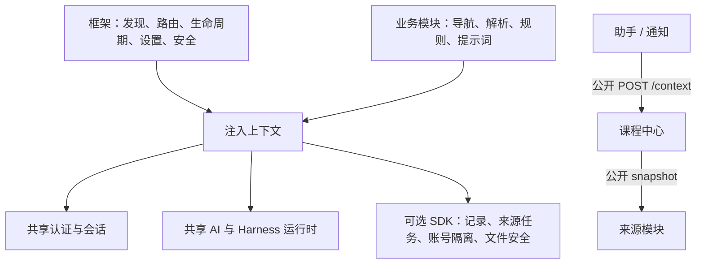

# ADR 0001：完整 main 与可独立启停的业务模块

日期：2026-10-16；状态：本次重构采用，随 PR 审阅。

## 问题与取舍

仓库已有 14 个模块，但框架的分类白名单、导航文案与共享服务的课程资料选择耦合业务。新增分类必须改宿主，资料选择也不能随课程中心一起演进。部分前端只在 mount 成功后返回样式清理，提前异常可能遗留资源。

选择目录和接口隔离：main 是包含全部已验收模块的集成应用；业务以独立目录挂载。保留模块 SDK，避免把通用存储、文件校验和账号隔离复制到各模块。单独维护只有空框架的 main 会使日常集成与交付脱节；把每个通用工具移回业务目录则会重复维护安全边界，因此均不采用。

## 边界

宿主仅内置设置页。业务导航由模块声明；同分类声明应保持一致，停用全部前端模块后该入口消失。新分类不需要框架改动。课程中心拥有学期、课程、邮件范围与上下文限长策略；助手和通知通过公开 API 消费。共享 AI 不指定校园角色，业务角色及规则由调用模块给出。共享认证适配器集中持有会话和私钥，属于跨模块公共能力。

`backend/services/campus/` 是可选 SDK，无模块 ID 调用、课程选择或业务编排；框架启动不依赖它。`web/campus.js` 提供公共记录与来源状态组件。SDK 变更仍需协调公共目录负责人。

## 生命周期与失败行为

模块停用后 API/静态资源不可访问，后端等待任务退出；数据保留，重新启用恢复。模块私有存储禁止互读。依赖停用时，聚合模块返回部分结果或明确 409；不会自动启用依赖。前端各模块拥有独立 AbortSignal，加载失败中止本模块，切页中止全部；资源在首次 await 前注册清理。返回 cleanup 用于补充成功挂载后的清理。

## 验收与演进

`check.sh` 覆盖合成框架契约、当前 15 模块集成、每个模块独立启用、逐个停用/再启用、停用依赖、清空 modules 后继续运行，以及课程聚合中账号切换拒绝混合数据。浏览器检查动态导航、无模块设置页与加载失败清理。开发期间保留完整模块目录；用户通过设置管理启停。未来新模块进入同一测试矩阵。测试不代表第三方网站随时可用，也不替代真实来源的独立验收。

集成期间保留 main 新增的首页学习助手与教务课程目录，并给新增模块声明导航。启动器采用自动 WSL 检测与 Edge 就绪打开，应用环境、互操作工具和实例状态与最新 main 统一放在 `.private/runtime/`；开发回归继续使用 `.codex/`。
