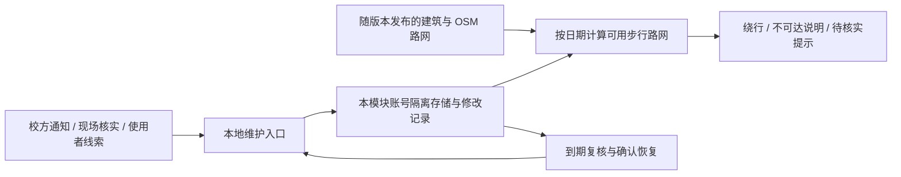

# 校园地图维护方案与决策记录

状态：试用方案，随 `codex/campus-map` 分支接受使用反馈；未作为学校官方通行信息发布。

## 需求与边界

日常维护应能记录施工、道路封闭、校门与建筑不可进入，区分未经证实的线索与有依据的限制，填写来源、开始时间、预计结束时间和复核日期。路线应避开已确认的步行限制，过期信息需要复核，恢复与撤回应可追溯。所有变化仍属于地图模块，采用现有存储、账号隔离、CSRF、备份与生命周期；无新服务、付费依赖或后台爬虫。

本轮按日维护施工与通行限制，界面明确显示评估日期。日期选择支持已知的计划限制；已恢复与撤回记录不再参与规划，不提供历史路况回放或小时级门禁时刻表。机动车限制不得直接当作步行限制录入。地图没有记录某处封闭，不代表已现场确认畅通。

## ADR-001：基础地图与通行维护分开

基础建筑和路网是带来源的代码资源；临时通行情况保存在 `context.store`，按统一认证账号版本隔离。地图升级不会覆盖手动维护记录。道路使用 OSM way ID 与两端 node ID 组成稳定引用；底图更新导致引用失效时显式提示重新定位。已确认的限制失去定位后暂停规划，避免悄悄忽略封路。

备选方案是直接改底图删除道路，但这会丢失来源和恢复依据，而且下次导入容易重新加入封闭道路。另建服务器或数据库会增加当前单机应用的维护成本，故复用框架。

## ADR-002：证据与通行状态分开，到期不自动开放

- 待核实：保留线索和来源，使用黄色标记。默认提示；使用者可以主动选择避开待核实范围。
- 已确认：需校方原文链接或现场核实说明。封闭道路从寻路图中移除；封闭校门／建筑不能作为起终点。仅提醒的记录不阻断。
- 需复核：超过复核日或预计结束日后明确提示。已确认封闭继续避让，不能凭预计工期自动宣布恢复。
- 已恢复：须补充恢复通行依据后人工确认，停止该条限制；另一条独立封闭记录不会被覆盖。
- 已撤回：用于错误或重复信息，保留修改历史。

信息按所选日期评估，尚未开始的限制显示计划状态。默认建议一周内复核，施工变化快时缩短为三天。未知信息、检索不到通知和已确认开放是不同状态。

## ADR-003：可复核的本地写入与失败处理

写入必须携带账号和记录集版本；账号变化或另一页面先修改时返回 409，保留当前表单供比较。保存前预览受影响的道路／地点，记录新增、修改、复核与撤销。保留最近 200 次修改，并提供撤销上次修改；框架的模块备份包含维护数据。入口中的来源链接只供用户打开，后端不抓取任意 URL。

施工可选校门／建筑、具体路段，或在地图用两个对角点圈选区域。圈选范围需要人依据通知或现场围挡确定，不能由一句模糊描述自动生成。区域会限制相交道路，以及地图中心点落在区域内的校门／建筑；只封一个入口时应选择实际受影响的路段。限制导致无路线时显示不可达，不画直线穿越。维护数据读取失败时地图仍可查看，路线暂停并提供重试。

## 维护节奏

1. 收到通知或现场反馈，先记录位置、是否影响行人、来源原文与日期。信息模糊先作为待核实线索。
2. 在地图预览受影响范围，确认后保存。选一条经过该处的典型路线验证绕行。
3. 每周打开“施工与通行维护”检查需复核条目；预计完工日临近或用户反馈不一致时优先核实。
4. 恢复通行时补充新证据，编辑为已恢复；错误记录撤回。不要删除记录来掩盖更正过程。
5. 基础地图更新单独走功能分支：保存来源与收录日期，检查 OSM 稳定引用、入口偏好、孤立路段和常用路线，查看维护页面的失配提示，验证后发布。当前不自动抓取并替换路网。

## 本次西门线索

使用者仅表示“可能是西门”，未确认位置或步行影响。本次查询了[学校公开公告](https://www.shanghaitech.edu.cn/1004/list.htm)及校方域名的西门、集慧路施工信息，未找到能确认当前步行封闭的现行通知。按待核实线索收录，不能据此声称西门已关闭。2024 年[校园道路交通安全管理办法](https://openinfo.shanghaitech.edu.cn/2024/0715/c20a1098532/page.htm)是一般管理规则，不是本次施工或恢复通行的证据。

## 非功能要求与验收

模块内实现；数据不外发；无后台轮询。前端切页清理请求与选路交互；保存采用版本冲突检测与账号隔离。检查覆盖过期封闭仍避让、计划日期、薄区域穿越、断路不可达、未知路段、待核实可选避让、恢复／撤销、多标签页冲突、账号切换与重载后持久化。使用合成封路验证，不把测试封闭写入真实运行数据。
